# Entity-relationship diagram

Source of truth: [`backend/prisma/schema.prisma`](../../backend/prisma/schema.prisma) plus the raw-SQL migration
[`*_availability_constraints`](../../backend/prisma/migrations/). Table names are the snake_case `@@map` names.
Every table also has `created_at` / `updated_at` (`timestamptz`), omitted below for brevity. All `id`s are UUIDs.

Constraints that are **not** visible in the diagram (raw SQL):

| Constraint | Table | Meaning |
|---|---|---|
| `vehicle_occupancy_no_overlap` | vehicle_occupancy | no two ACTIVE rows of one vehicle overlap on `[starts_at, blocked_until)` |
| `driver_assignment_no_overlap` | driver_assignment | no two ACTIVE rows of one driver overlap on `[starts_at, ends_at)` |
| `driver_assignment_one_active_per_booking` | driver_assignment | ≤ 1 ACTIVE assignment per booking |
| `vehicle_driver_one_vehicle_per_driver` | vehicle_driver | partial unique: a normal driver (`is_owner_driver = false`) links to one vehicle |
| `quotation_expires_before_start` and other `CHECK`s | various | see migration file |

```mermaid
erDiagram
    user ||--o{ user_role : has
    user ||--o| customer_profile : "is customer"
    user ||--o| owner_profile : "is owner"
    user |o--o| driver_profile : "logs in as (optional)"
    user ||--o{ notification : receives

    owner_profile ||--o{ driver_profile : employs
    owner_profile ||--o{ vehicle : owns
    owner_profile ||--o{ owner_operating_area : "operates in"
    area ||--o{ owner_operating_area : ""
    owner_profile ||--o{ document : "verified by"
    driver_profile ||--o{ document : "verified by"
    vehicle ||--o{ document : "verified by"

    vehicle_category ||--o{ vehicle : classifies
    vehicle ||--o{ vehicle_image : has
    vehicle ||--o{ indicative_price : has
    vehicle ||--o{ vehicle_driver : "driven by"
    driver_profile ||--o{ vehicle_driver : drives

    customer_profile ||--o{ trip_request : submits
    vehicle ||--o{ trip_request : "requested for"
    trip_request ||--o{ trip_stop : "ordered stops"
    trip_request ||--o| quotation : "answered by"
    quotation ||--o{ quotation_charge : "line items"
    quotation ||--o| booking : "accepted into"
    customer_profile ||--o{ booking : books
    vehicle ||--o{ booking : "booked as"

    vehicle ||--o{ vehicle_occupancy : "occupied by"
    booking ||--o{ vehicle_occupancy : "holds / books"
    booking ||--o{ driver_assignment : "assigned"
    driver_profile ||--o{ driver_assignment : works
    booking ||--o{ trip_event : "trip history"

    trip_request ||--o{ trip_request_status_history : history
    quotation ||--o{ quotation_status_history : history
    booking ||--o{ booking_status_history : history

    user {
        uuid id PK
        string email UK
        string phone "private until booking CONFIRMED"
        string password_hash
        string full_name
        user_status status
        timestamptz email_verified_at
    }
    user_role {
        uuid id PK
        uuid user_id FK
        role role "UK(user_id, role)"
    }
    customer_profile {
        uuid id PK
        uuid user_id FK,UK
    }
    owner_profile {
        uuid id PK
        uuid user_id FK,UK
        owner_type owner_type
        string business_name "required if BUSINESS"
        string business_reg_number
        verification_status verification_status
        timestamptz verified_at
    }
    driver_profile {
        uuid id PK
        uuid owner_id FK
        uuid user_id FK,UK "nullable"
        string full_name
        string phone "visible to customer after assignment"
        string licence_number UK
        timestamptz licence_expires_at
        verification_status verification_status
        boolean is_owner_driver
        boolean is_active
    }
    document {
        uuid id PK
        document_subject subject_type
        uuid owner_id FK "exactly one of"
        uuid driver_id FK "exactly one of"
        uuid vehicle_id FK "exactly one of"
        string document_type
        string storage_key "private, never a public URL"
        document_status status
        uuid reviewed_by_user_id
        timestamptz reviewed_at
        string rejection_reason
        timestamptz valid_until
    }
    area {
        uuid id PK
        string name
        string slug UK
        boolean is_active
        int sort_order
        boolean is_sample
    }
    owner_operating_area {
        uuid owner_id PK,FK
        uuid area_id PK,FK
    }
    vehicle_category {
        uuid id PK
        string name UK
        string slug UK
        boolean is_active
        int sort_order
    }
    vehicle {
        uuid id PK
        uuid owner_id FK
        uuid category_id FK
        string make
        string model
        int year
        string registration_number UK
        int seats
        int luggage_capacity
        boolean air_conditioned
        transmission transmission
        fuel_type fuel_type
        text_array features
        string description
        vehicle_approval_status approval_status
        boolean is_active
    }
    vehicle_image {
        uuid id PK
        uuid vehicle_id FK
        string storage_key
        int sort_order
        boolean is_primary
    }
    vehicle_driver {
        uuid id PK
        uuid vehicle_id FK "FK(vehicle_id, owner_id)"
        uuid driver_id FK "FK(driver_id, owner_id) + FK(driver_id, is_owner_driver)"
        uuid owner_id
        boolean is_owner_driver
    }
    indicative_price {
        uuid id PK
        uuid vehicle_id FK
        pricing_unit pricing_unit "UK(vehicle_id, pricing_unit)"
        decimal amount "12,2"
        char3 currency "LKR"
        string notes
    }
    trip_request {
        uuid id PK
        uuid customer_id FK
        uuid vehicle_id FK "FK(vehicle_id, owner_id)"
        uuid owner_id
        trip_type trip_type
        string pickup_address
        decimal pickup_lat
        decimal pickup_lng
        string destination_address
        decimal destination_lat
        decimal destination_lng
        timestamptz requested_start_at
        timestamptz requested_return_at
        int requested_hours
        int passenger_count
        string luggage_notes
        string special_requirements
        string flight_number
        timestamptz flight_arrival_at
        trip_request_status status
    }
    trip_stop {
        uuid id PK
        uuid trip_request_id FK
        int sequence "UK(trip_request_id, sequence)"
        string address
        decimal lat
        decimal lng
    }
    quotation {
        uuid id PK
        uuid trip_request_id FK,UK
        uuid vehicle_id FK
        timestamptz starts_at
        timestamptz ends_at
        decimal base_amount
        decimal total_amount
        char3 currency
        string notes
        timestamptz expires_at "<= starts_at"
        quotation_status status
    }
    quotation_charge {
        uuid id PK
        uuid quotation_id FK
        string label
        decimal amount
        int sort_order
    }
    booking {
        uuid id PK
        uuid quotation_id FK,UK
        uuid customer_id FK
        uuid vehicle_id FK
        uuid owner_id
        timestamptz starts_at
        timestamptz ends_at
        decimal total_amount
        char3 currency
        booking_status status
        trip_status trip_status "separate lifecycle"
        timestamptz confirmed_at
        timestamptz cancelled_at
        timestamptz expired_at
    }
    vehicle_occupancy {
        uuid id PK
        uuid vehicle_id FK
        occupancy_kind kind "BLOCK | HOLD | BOOKING"
        occupancy_status status "ACTIVE | RELEASED"
        timestamptz starts_at
        timestamptz ends_at
        timestamptz blocked_until "ends_at + buffer"
        timestamptz expires_at "HOLD only"
        uuid booking_id FK "null for BLOCK"
        string reason
        uuid created_by_user_id
        timestamptz released_at
    }
    driver_assignment {
        uuid id PK
        uuid booking_id FK
        uuid driver_id FK
        timestamptz starts_at
        timestamptz ends_at
        driver_assignment_status status
        uuid assigned_by_user_id
        timestamptz ended_at
    }
    trip_event {
        uuid id PK
        uuid booking_id FK
        trip_status from_status
        trip_status to_status
        uuid actor_user_id
        string note
        timestamptz occurred_at
    }
    trip_request_status_history {
        uuid id PK
        uuid trip_request_id FK
        trip_request_status from_status
        trip_request_status to_status
        uuid actor_user_id
        string reason
    }
    quotation_status_history {
        uuid id PK
        uuid quotation_id FK
        quotation_status from_status
        quotation_status to_status
        uuid actor_user_id
        string reason
    }
    booking_status_history {
        uuid id PK
        uuid booking_id FK
        booking_status from_status
        booking_status to_status
        uuid actor_user_id
        string reason
    }
    notification {
        uuid id PK
        uuid user_id FK
        string type
        string title
        string body
        json data
        timestamptz read_at
    }
    audit_log {
        uuid id PK
        uuid actor_user_id
        string action
        string entity_type
        string entity_id
        json metadata
    }
    platform_setting {
        uuid id PK
        string key UK
        json value
        string description
    }
```

`audit_log` and `platform_setting` deliberately have no foreign keys (audit rows must survive deletes; settings are global).

## Design notes

- **Per-entity status history tables** (rather than one polymorphic `status_history`): each row has a real FK and a
  typed enum column, so invalid statuses and orphaned rows are impossible. Trip status history is `trip_event`.
- **Composite foreign keys** keep denormalised `owner_id` / `vehicle_id` / `is_owner_driver` columns truthful, so a
  driver can never be linked to another owner's vehicle and a normal driver cannot pose as an owner-driver to escape
  the one-vehicle rule.
- **One quotation per trip request** (`quotation.trip_request_id` unique) because revised quotations are not allowed.
- **`driver_profile.user_id` is unique**, so one person has at most one driver profile and the driver-overlap
  constraint covers the person.
- Payment, refund, commission, settlement and cancellation-policy models are **not yet modelled** (Stage 2B).
