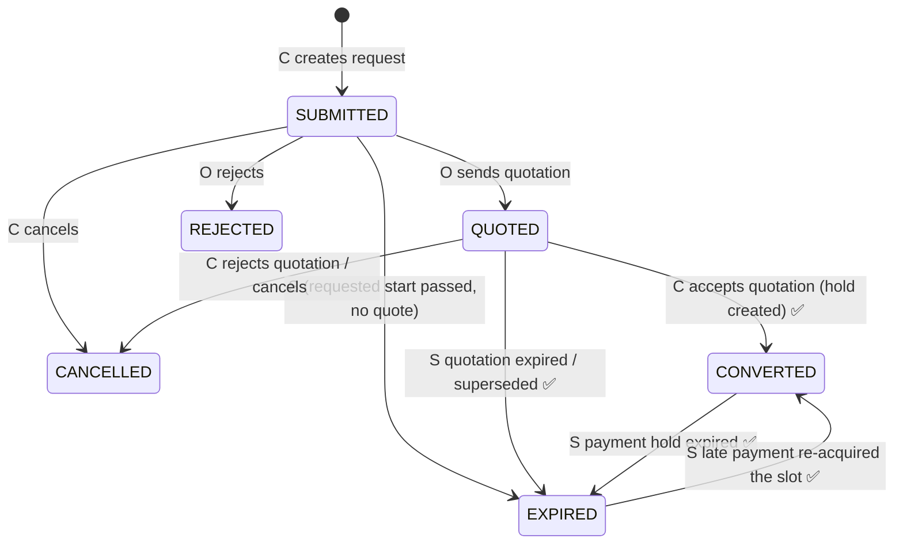
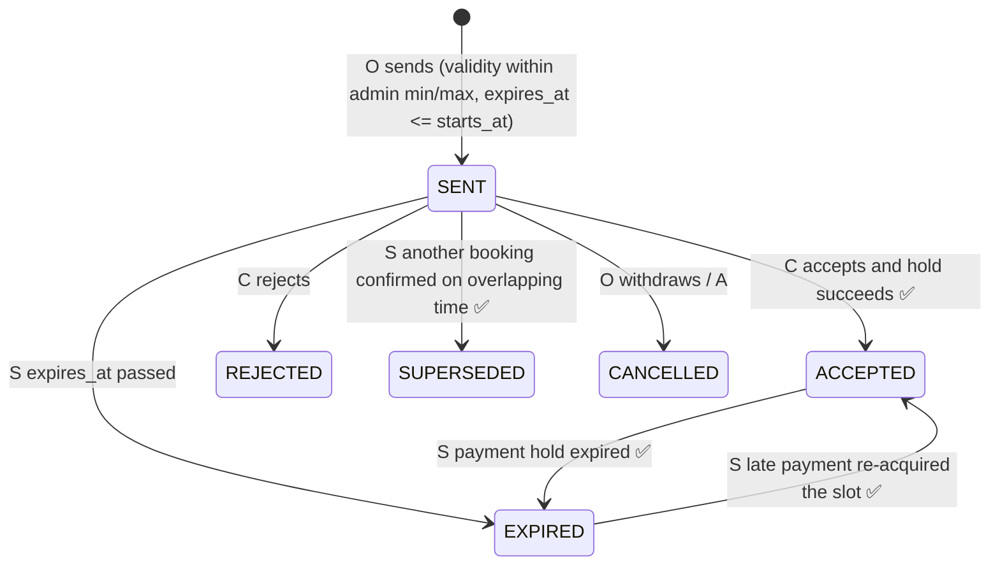
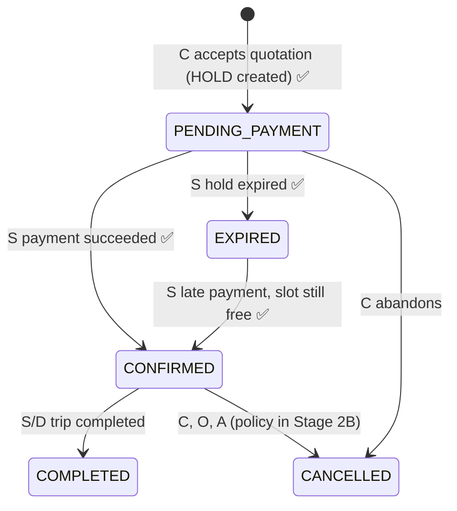
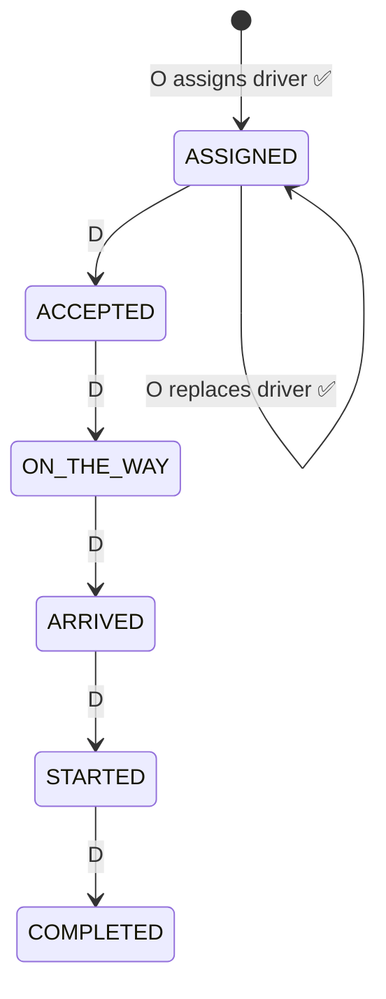

# State machines

Each lifecycle is a **separate column with its own enum** (rule 19). Payment, refund and settlement lifecycles will be
added as separate models in Stage 2B and must never be folded into `BookingStatus`.

Every transition writes a history row (rule 20): `trip_request_status_history`, `quotation_status_history`,
`booking_status_history`, and `trip_event` for trip status. `actor_user_id` is `NULL` for system transitions
(scheduler, payment webhook).

Legend for "who": **C** customer, **O** owner, **D** driver (incl. owner-driver), **A** admin, **S** system.
✅ = implemented in `availability.service.ts` (Stage 2A); others are specified here and implemented in later stages.

## TripRequest (`trip_request.status`)

| From | To | Who | Notes |
|---|---|---|---|
| — | SUBMITTED | C | owner sees name, trip details, passenger count only |
| SUBMITTED | QUOTED | O | together with quotation creation |
| SUBMITTED | REJECTED | O | `rejection_reason` |
| SUBMITTED / QUOTED | CANCELLED | C | |
| SUBMITTED | EXPIRED | S | no quotation before requested start |
| QUOTED | CONVERTED | C | ✅ `createHold` |
| QUOTED | EXPIRED | S | ✅ quotation superseded (`confirmHold`); quotation expiry job (later) |
| CONVERTED | EXPIRED | S | ✅ `releaseExpiredHolds` |
| EXPIRED | CONVERTED | S | ✅ `confirmHold` late payment that re-acquires the slot |

## Quotation (`quotation.status`)

There is no transition back to SENT and no "revised" state. The customer can only accept or reject.

| From | To | Who | Notes |
|---|---|---|---|
| — | SENT | O | `expires_at - now()` within `quotationExpiryMinHours`..`quotationExpiryMaxHours` (service, later); `expires_at <= starts_at` (DB CHECK) |
| SENT | ACCEPTED | C | ✅ only if the hold insert succeeds (same transaction) |
| SENT | REJECTED | C | |
| SENT | EXPIRED | S | expiry job (later stage) |
| SENT | SUPERSEDED | S | ✅ on `confirmHold` for overlapping `[starts_at, ends_at + buffer)` on the same vehicle |
| SENT | CANCELLED | O, A | |
| ACCEPTED | EXPIRED | S | ✅ hold released without payment |
| EXPIRED | ACCEPTED | S | ✅ late payment; only from the hold-expiry path |

## Booking (`booking.status`)

| From | To | Who | Notes |
|---|---|---|---|
| — | PENDING_PAYMENT | C | ✅ `createHold` |
| PENDING_PAYMENT | CONFIRMED | S | ✅ `confirmHold` (called by payment module) |
| PENDING_PAYMENT | EXPIRED | S | ✅ `releaseExpiredHolds` |
| EXPIRED | CONFIRMED | S | ✅ `confirmHold` if the slot can be re-acquired, else `HoldExpiredError` → refund |
| CONFIRMED | COMPLETED | S | when trip status becomes COMPLETED |
| PENDING_PAYMENT / CONFIRMED | CANCELLED | C, O, A | releases occupancy and assignment; refund handled by Stage 2B |

## Trip (`booking.trip_status`, history in `trip_event`)

`trip_status` is `NULL` until a driver is assigned.

| From | To | Who | Notes |
|---|---|---|---|
| — / ASSIGNED / ACCEPTED / ON_THE_WAY / ARRIVED | ASSIGNED | O | ✅ `assignDriver`; booking must be CONFIRMED; not allowed once STARTED |
| ASSIGNED | ACCEPTED | D | assigned driver only |
| ACCEPTED | ON_THE_WAY | D | |
| ON_THE_WAY | ARRIVED | D | |
| ARRIVED | STARTED | D | |
| STARTED | COMPLETED | D | booking → COMPLETED |

## Occupancy (`vehicle_occupancy.kind` / `.status`)

| Kind | Created by | ACTIVE → RELEASED when |
|---|---|---|
| BLOCK | O (`createOwnerBlock`) ✅ | O releases (`releaseOwnerBlock`) ✅ |
| HOLD | C (`createHold`) ✅ | hold expired (`releaseExpiredHolds`, or lazily in `createHold`/`createOwnerBlock`) ✅ |
| BOOKING | HOLD converted in `confirmHold` ✅ | booking cancelled (later stage) |

## Driver assignment (`driver_assignment.status`)

ACTIVE → REPLACED (owner assigns another driver ✅) · ACTIVE → CANCELLED (booking cancelled, later).

## Verification lifecycles

- `owner_profile.verification_status`, `driver_profile.verification_status`: PENDING → APPROVED / REJECTED (A);
  APPROVED → SUSPENDED (A); SUSPENDED → APPROVED (A).
- `vehicle.approval_status`: PENDING → APPROVED / REJECTED (A); APPROVED → SUSPENDED (A). Approval requires at
  least one linked, approved driver (rule 3, service-layer).
- `document.status`: PENDING → APPROVED / REJECTED (A, with `rejection_reason`).
- `user.status`: ACTIVE ⇄ SUSPENDED (A); any → DEACTIVATED (user/A).

## Contact privacy (rule 14)

Enforced in the service/serialisation layer (Stage 3+); the schema keeps contact data only on `user` and
`driver_profile` so there is a single place to redact.

| Viewer | Data | Visible when |
|---|---|---|
| Owner | customer `full_name`, trip details, `passenger_count` | from SUBMITTED |
| Owner | customer `email`, `phone` | only when booking `status IN (CONFIRMED, COMPLETED)` |
| Customer | driver `full_name`, `phone`, vehicle registration | only when an ACTIVE `driver_assignment` exists |
| Customer | owner business name, vehicle details (non-contact) | public listing |
| Driver | customer name, phone, pickup details | only for bookings they are actively assigned to |
